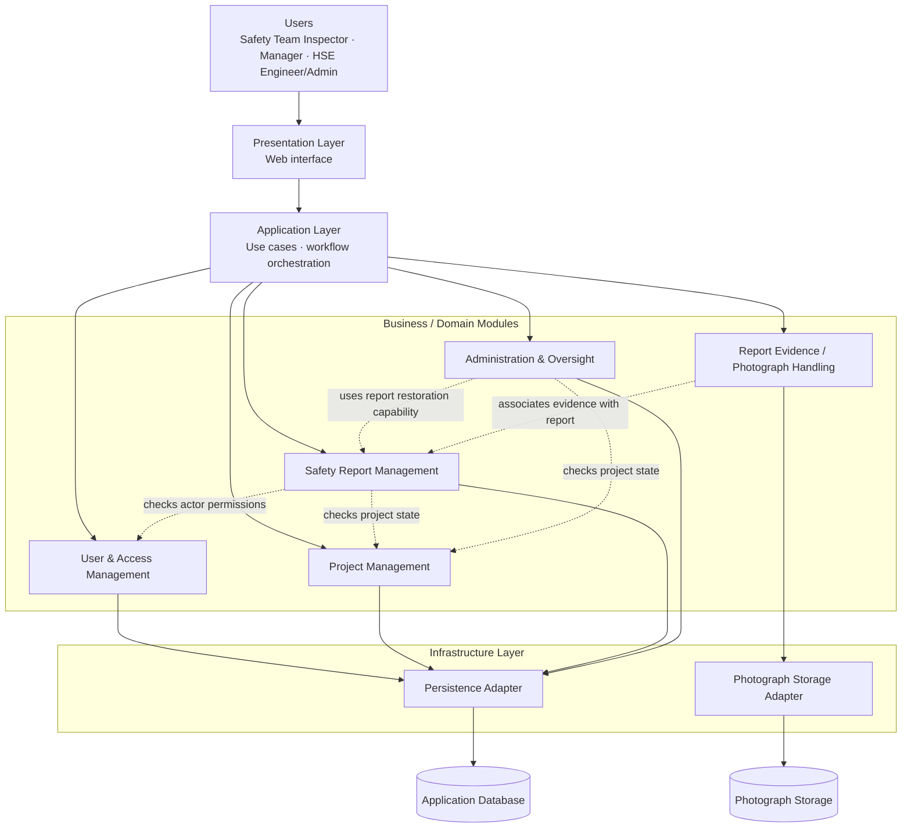

# Architecture Document

**Project:** HSE Safety Reporting System  
**Status:** Draft — consolidated from agreed project discussions  
**Last updated:** 12 November 2026

> **Decision-integrity note:** This document records the project decisions that can be reconstructed from the shared project discussions. Where the exact wording or option selected in an earlier ADR is not available in the current conversation context, the document states the architectural direction conservatively and marks the point for verification against the accepted ADR. No technology stack, deployment platform, or unconfirmed integration is prescribed here.

## 1. System Overview

The HSE Safety Reporting System is a web-based application for recording and managing safety reports across projects.

The system supports the safety-report lifecycle: a Safety Team inspector creates and submits a standardized safety report; corrective actions are followed through the report's progress; and the responsible Manager can review reports for the project. An HSE Engineer/Admin has oversight across projects and administrative authority, including restoring deleted reports while a project remains open.

A project is assigned to exactly one Manager. A Manager may be responsible for multiple projects. The HSE Engineer/Admin oversees all projects.

The system is intended to be a relatively small-to-medium website developed by a small student team. Its architecture should therefore remain understandable, cohesive, and practical to implement and maintain.

### 1.1 Primary users and responsibilities

- **Safety Team Inspector:** Creates and submits safety reports using the standardized report form.
- **Manager:** Is assigned to one or more projects, reviews reports belonging to those projects, and is responsible for their project-level follow-up. A Manager may view, but must not change, individual Closed reports after the project has been closed.
- **HSE Engineer/Admin:** Oversees all projects and performs system-level administrative actions, including restoring deleted reports while the relevant project is open.

The HSE Engineer/Admin and Manager are distinct responsibility scopes: the Manager is associated with assigned projects, while the HSE Engineer/Admin has cross-project oversight.

## 2. Architectural Goals and Drivers

The architecture should:

1. **Reflect the domain:** Keep project, report, corrective-action/progress, user-role, and administrative responsibilities clear.
2. **Protect business rules:** Enforce report and project lifecycle rules consistently, regardless of which screen or user action invokes them.
3. **Preserve authorization boundaries:** Separate project-scoped Manager access from the HSE Engineer/Admin's cross-project oversight.
4. **Support maintainability:** Use a structure that a small student team can understand, implement, test, and change without unnecessary operational complexity.
5. **Avoid unnecessary distribution:** Do not introduce independently deployed services or infrastructure unless an accepted ADR explicitly requires them.
6. **Keep responsibilities cohesive:** Organize business capabilities so that changes to one capability do not unnecessarily affect unrelated capabilities.
7. **Support reliable data handling:** Keep authoritative ownership of report and project data clear and ensure lifecycle changes are validated before persistence.
8. **Support the agreed media scope:** Report attachments are photographs only; do not design for arbitrary document or video uploads unless the requirements are changed.

## 3. Architectural Significant Requirements (ASRs)

The following ASRs are derived from the agreed product rules and architecture discussions. They describe qualities or constraints that materially influence the architecture.

| ASR ID | Architectural requirement | Architectural implication |
|---|---|---|
| ASR-01 | The system must enforce role- and project-scoped access. | Authorization must be applied in the application/business logic, not only by hiding interface controls. |
| ASR-02 | A project has exactly one assigned Manager, while a Manager may manage multiple projects. | Project-to-Manager assignment must be represented and validated as a one-to-many relationship from Manager to Project. |
| ASR-03 | The HSE Engineer/Admin must be able to oversee all projects. | Cross-project access must be represented as a distinct authorization scope from Manager access. |
| ASR-04 | Reports have a lifecycle involving submission and Open/Closed progress. | Report state transitions and their rules must be handled consistently in the business logic. |
| ASR-05 | A Manager may view but may not change an individual Closed report after its project is closed. | The application must evaluate both report state and project state before allowing a Manager to modify a report. |
| ASR-06 | Deleted reports can be restored by an Admin while the project is open. | Deletion/restoration state must be retained sufficiently to support restoration, and restoration must validate the project's state and the actor's authority. |
| ASR-07 | Reports use a standardized form and may contain multiple safety violations only when the report concerns an incident. | Report validation must enforce the incident/violation relationship independently of the user interface. |
| ASR-08 | Report evidence is limited to photographs. | The attachment capability and validation should be limited to photograph files; other media/document types are out of scope. |
| ASR-09 | The system is a small-to-medium website built by a small student team. | Prefer a simple, cohesive application structure and avoid unnecessary distributed-system complexity. |

## 4. Selected Architectural Style and Rationale

### 4.1 Architectural direction

Use a **modular, layered web application** as the working architectural direction:

- **Modular:** Organize the application around cohesive business capabilities and keep their responsibilities and interfaces explicit.
- **Layered:** Separate user-interface concerns, application/business rules, and persistence/infrastructure concerns.
- **Single deployable application:** Keep the modules within one application and one deployment unit unless the accepted ADRs specify otherwise.

This direction fits the project's scale and team size: it provides separation of concerns and clear business boundaries without requiring the operational overhead of multiple independently deployed services.

> **ADR verification required:** The exact option label and wording selected in the team's architecture-style ADR should be copied here when the accepted ADR is available. The project discussion records that options were explicitly locked, but the full option descriptions are not present in the current context. This section therefore records the conservative architectural direction rather than claiming an exact ADR title or option label.

### 4.2 Rationale

- The system is a relatively small-to-medium website, not a collection of independently operated products.
- A small student team benefits from one cohesive codebase and a straightforward development/deployment workflow.
- Layer boundaries help prevent business rules from being duplicated in screens or persistence code.
- Business modules provide a place for domain-specific rules while shared technical concerns can be handled consistently.
- The design can evolve if future scale or deployment needs justify a different structure, without introducing that complexity prematurely.

## 5. Major Components and Modules

The components below describe logical responsibilities. They do not mandate specific frameworks, programming languages, folder names, or database products.

### 5.1 Presentation Layer

**Responsibilities**
- Provide the web interface for inspectors, Managers, and HSE Engineer/Admin users.
- Display information and actions permitted to the current user.
- Collect report, project, and corrective-action information.
- Present validation feedback and lifecycle status.

**Boundary**
- Must not be the sole enforcer of permissions or business rules.
- Must not directly implement persistence rules.
- Sends user requests to the application layer and renders the result.

### 5.2 Application Layer

**Responsibilities**
- Coordinate user use cases and workflows.
- Identify the acting user and invoke the appropriate authorization checks.
- Coordinate operations across business modules where a use case requires them.
- Apply transaction boundaries and return suitable results to the presentation layer.

**Boundary**
- Orchestrates business operations but should not become a repository of duplicated domain rules.
- Does not expose database-specific details to the presentation layer.

### 5.3 Business/Domain Modules

The business modules should be organized around the system's domain responsibilities. The following logical modules are appropriate to the agreed requirements; exact package names can be chosen during implementation.

#### A. User and Access Management

- Represents system users and their roles.
- Enforces the distinction between Safety Team Inspector, Manager, and HSE Engineer/Admin.
- Provides authorization decisions to application use cases.
- Supports project-scoped Manager access and cross-project HSE Engineer/Admin oversight.

**Boundary:** Owns user/role and access-policy responsibilities. It should not own report lifecycle data.

#### B. Project Management

- Maintains project information and project lifecycle state.
- Maintains the assignment of exactly one Manager to each project.
- Supports a Manager being assigned to multiple projects.
- Provides project-state and project-access information to other modules.

**Boundary:** Owns project data and Manager assignment. It does not own the contents or lifecycle of individual safety reports.

#### C. Safety Report Management

- Creates and maintains standardized safety reports.
- Supports submission by a Safety Team inspector.
- Applies report-specific validation, including the rule that multiple safety violations are supported only when the report concerns an incident.
- Maintains report progress as Open or Closed, according to the agreed corrective-action process.
- Applies report-level lifecycle rules in coordination with project state and authorization.

**Boundary:** Owns report content and report progress. It should consult Project Management for project state and User/Access Management for authorization rather than duplicating those responsibilities.

#### D. Report Evidence/Photograph Handling

- Handles photograph evidence associated with reports.
- Validates that uploaded evidence is within the agreed photograph-only scope.
- Associates photographs with the relevant report.

**Boundary:** Owns photograph handling and references/metadata needed by the report workflow. It must not expand the product scope to general file, video, or document management.

#### E. Administration and Oversight

- Supports HSE Engineer/Admin cross-project oversight.
- Supports administrative report recovery, including restoring deleted reports while the project is open.
- Applies administrative authorization before privileged actions.

**Boundary:** Provides administrative use cases; it should use the owning Project and Safety Report capabilities rather than creating parallel copies of their data or business rules.

### 5.4 Infrastructure and Persistence Layer

**Responsibilities**
- Implements storage and retrieval required by the business modules.
- Provides database access, photograph storage integration, and other technical adapters.
- Handles technical concerns such as persistence failures and configuration.

**Boundary**
- Business modules define what data and operations they need; infrastructure implements how those needs are fulfilled.
- Database and storage-specific details should not leak into presentation code or domain rules.

## 6. Interfaces and Interactions Between Components

Interactions should occur through application-level use cases and explicit module interfaces. A module should request another module's capability through its defined interface rather than reaching into that module's internal implementation.

### 6.1 Main interactions

1. **Report creation and submission**
   - The inspector uses the Presentation Layer.
   - The Application Layer identifies the actor and coordinates the use case.
   - User/Access Management verifies the actor's permission.
   - Project Management verifies the relevant project context.
   - Safety Report Management validates and records the report and its submission.
   - Photograph Handling stores and associates any permitted photograph evidence.

2. **Manager review**
   - The Manager requests reports for an assigned project.
   - User/Access Management verifies the Manager's project-scoped access.
   - Project Management supplies the project context and state.
   - Safety Report Management supplies the relevant report information.
   - The Presentation Layer displays only the permitted actions.

3. **Report progress or corrective-action update**
   - The Application Layer coordinates the requested update.
   - Access is checked for the acting user and project.
   - Safety Report Management validates the report transition.
   - Where the project is closed, the rule preventing a Manager from changing an individual Closed report must be enforced.
   - The change is persisted only after the applicable rules pass.

4. **Administrative report restoration**
   - The HSE Engineer/Admin initiates restoration.
   - User/Access Management verifies administrative authority.
   - Project Management provides the current project state.
   - Safety Report Management performs restoration only if the project is open and the report is eligible for restoration.
   - The operation is persisted through the infrastructure layer.

### 6.2 Cross-module rules

- Authorization is checked on the server/application side for every protected use case.
- A Manager's access is limited to projects assigned to that Manager.
- HSE Engineer/Admin oversight is cross-project.
- Report-level actions that depend on project state must consult the authoritative project state.
- The same business rule must not be independently reimplemented in multiple user-interface screens.

## 7. Relevant External Systems and Services

No specific third-party service or external integration has been confirmed in the available project decisions.

The architecture may require technical adapters for:

- **Database/persistent storage:** Stores users, roles, projects, reports, report state, and relevant metadata.
- **Photograph storage:** Stores photograph evidence and maintains its association with reports.

The selected database, hosting provider, photograph-storage service, authentication provider, and any email/notification service remain implementation decisions unless specified in an accepted ADR or the PRD.

Do not assume integrations with external HSE platforms, analytics services, payment systems, or notification providers.

## 8. Important Data Responsibilities

Data should have one clear logical owner. Other modules may use that data through defined interfaces but should not maintain competing authoritative copies.

| Data area | Logical owner | Key responsibilities |
|---|---|---|
| Users and roles | User and Access Management | User identity within the application, role membership, and authorization context. |
| Project records | Project Management | Project details, project state, and exactly one assigned Manager per project. |
| Manager assignments | Project Management | Ensures one Manager per project and allows one Manager to manage multiple projects. |
| Safety report content | Safety Report Management | Standardized report fields, report submission information, and report progress. |
| Safety violations | Safety Report Management | Stores violation information and enforces the incident-only multiple-violation rule. |
| Corrective-action/progress information | Safety Report Management | Supports the agreed Open/Closed report progress lifecycle. |
| Photograph evidence | Report Evidence/Photograph Handling | Photograph data/storage references and association with reports. |
| Deleted/restorable report state | Safety Report Management | Retains the information needed for authorized restoration while the project remains open. |

### 8.1 Important integrity rules

- Each project is assigned exactly one Manager.
- A Manager may be assigned to multiple projects.
- A Manager's report access is restricted to assigned projects.
- HSE Engineer/Admin has cross-project oversight.
- Multiple safety violations are permitted only for reports concerning an incident.
- Report progress uses the agreed **Open** and **Closed** states; do not introduce additional progress states without an approved requirement.
- A Manager may view but not change an individual Closed report after its project has been closed.
- An Admin may restore a deleted report only while its project is open.
- Report evidence is limited to photographs.

## 9. Architectural Constraints

1. The system is a web-based HSE safety-reporting application.
2. The expected scale is small-to-medium, and the development team is a small student team.
3. The architecture must follow the agreed PRD, glossary, ASRs, and accepted ADRs.
4. Business rules must be enforced outside the presentation layer.
5. Manager authorization is project-scoped; HSE Engineer/Admin oversight is cross-project.
6. A project must have exactly one assigned Manager.
7. The report progress vocabulary is Open and Closed.
8. Multiple safety violations are allowed only for incident reports.
9. Report evidence is photographs only.
10. Admin restoration of deleted reports is allowed while the project is open.
11. After project closure, a Manager may view but may not change an individual Closed report.
12. Do not add unapproved external services, integrations, architectural layers, or deployment complexity.

## 10. Architecture Diagram

The diagram shows the intended logical structure and the main dependency direction. It is technology-neutral.

**Dependency principle:** The Presentation Layer depends on application use cases. Business modules own domain rules and use infrastructure through defined persistence/storage abstractions. Infrastructure details should not determine business rules.

## 11. Links and References to Relevant ADRs

The architecture must be read together with the accepted ADRs. The project discussions confirm that architectural options were discussed and locked, but the exact ADR filenames, titles, and option descriptions are not available in the current context. To avoid fabricating references, use the team's actual accepted ADR filenames in the table below.

| ADR reference | Decision area | Relationship to this document |
|---|---|---|
| Accepted ADR — architectural style (filename to verify) | Overall architectural style | Confirms or corrects the modular/layered, single-deployable direction in Section 4. |
| Accepted ADR — module/component organization (filename to verify) | Major business and technical modules | Confirms the module boundaries in Section 5. |
| Accepted ADR — data ownership/storage (filename to verify) | Data ownership and persistence | Confirms Section 8 and the persistence boundaries. |
| Accepted ADR — external services/integrations (filename to verify) | External system boundaries | Confirms Section 7. |
| Accepted ADR — report evidence/media (filename to verify) | Supported report attachment type | Confirms the photograph-only constraint in Sections 5, 8, and 9. |

### Related project documents

- `PRD.md` — authoritative product intent, functional requirements, non-functional requirements, business rules, and constraints.
- `AGENTS.md` — instructions and architectural constraints for AI coding agents working in the repository.
- Accepted ADR documents — the rationale and final decisions for significant architectural choices.
- Project glossary / ubiquitous language — authoritative terminology for roles, reports, submission, progress, and project lifecycle.

---

## Items to Verify Before Treating This Document as Final

1. Replace the ADR placeholders with the exact accepted ADR filenames, titles, statuses, and selected options.
2. Confirm the precise architectural-style label and rationale against the accepted architecture ADR.
3. Confirm the exact business-module and technical-module decomposition against the relevant ADRs.
4. Confirm any database, authentication, hosting, or photograph-storage choices only if they were explicitly decided in the ADRs or PRD.
5. Cross-check all requirement wording and identifiers against the final `PRD.md`, especially the agreed NFRs and ASR traceability.

Until these checks are completed, treat this as a **working architecture baseline**, not as a replacement for the accepted ADRs or PRD.
